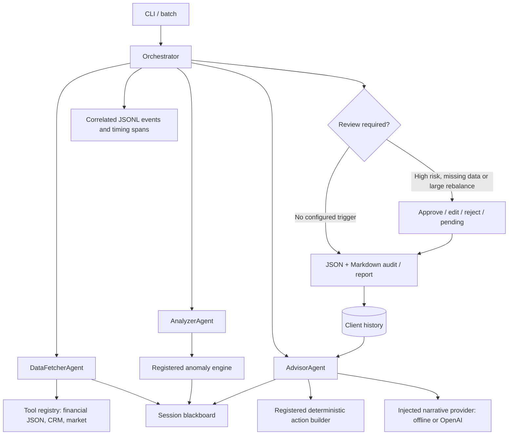

# Glynac Assignment — Wealth Advisor Assistant

A lightweight Python assignment demonstrating a central orchestrator, three specialized agents, registered tools, session and persistent memory, and an explicit human review checkpoint. It ingests financial JSON, retrieves simulated CRM and market context, detects risk signals, and exports evidence-linked advisory proposals.

**The default demo runs offline without API keys.** Optional OpenAI integration generates narrative around application-calculated findings. This is an educational simulation: thresholds and health scores are illustrative, market figures are fixtures, and no trades or client messages are sent.

## Quick start

Python 3.10 or newer. From the project folder:

```bash
python3 -m venv .venv
source .venv/bin/activate
python -m pip install -r requirements.txt
python -m src.main --client 101 --auto-approve --quiet
```

The command prints the report path. `--auto-approve` explicitly selects a demonstration approval policy; reports identify it as automatic. To review interactively instead:

```bash
python -m src.main --client 101
```

The original `python src/main.py --client 101` invocation also works. Run commands from this checkout so bundled sample data is available.

## Architecture and execution flow



The orchestrator executes `DATA_FETCH → ANALYSIS → ADVISORY_SYNTHESIS → HITL_REVIEW → EXPORT → PERSIST_MEMORY`. It converts stage failures into typed workflow outcomes and writes a final `run_status.json` receipt. Agents exchange validated data through a session blackboard; tools return a common result envelope.

| Assignment requirement | Implementation | How to verify |
|---|---|---|
| Central coordination | `OrchestratorAgent`, stage boundaries and typed outcomes | Normal run and injected failures |
| At least two specialized agents | Fetcher, analyzer, advisor with separate responsibilities | Agent integration tests |
| Tool abstraction | `BaseTool`, `ToolResult`, `ToolRegistry`; five registered tools | Registry and input validation tests |
| API context | Simulated CRM and benchmark tools | Normal and degraded CRM examples |
| Analysis and anomalies | Transactions, allocation drift, cash, concentration, reserves, spending | Formula and edge-case tests |
| Error handling | Stage failures, degraded CRM, narrative fallback, atomic replacement | Failure regression suite |
| Logging | Session/client/stage/outcome events and execution spans | `agent_execution.jsonl`, `run_status.json` |
| Short-term memory | Deep-copied session state and mutation audit summaries | Blackboard tests |
| Long-term memory | Per-client JSON observations and review outcomes | Repeated-session demo |
| Human-in-the-loop | Explicit approval, editable actions, rejection and pending outcomes | Review tests and example dossiers |
| Working code, README, sample I/O | Offline CLI, bounded dependencies, examples, CI | Fresh installation and walkthrough |

### Agent and provider contracts

- `BaseAgent.run(...) -> AgentResponse`: success, data, error and timing. Unexpected exceptions are caught at the orchestrator's stage boundary.
- `BaseTool.run(...) -> ToolResult`: validates arguments with Pydantic, times execution, and returns errors without embedding rejected input payloads.
- `BaseLLMClient.generate_structured(...)`: shared provider interface. `AdvisoryContext` contains current analysis, deterministic actions and historical context. `AdvisoryNarrative` contains a summary, explanations keyed to existing actions, and agenda topics.
- `WorkflowResult`: typed internally, serialized into the existing dictionary return interface. Status is `COMPLETED`, `PENDING_REVIEW`, `REJECTED`, or `FAILED`.
- `OrchestratorAgent` accepts injected tools, logger, memory store, review gate, provider and output directory. Tests use these seams without changing agent logic.

The advisor obtains actions through `advisory_action_builder`. The provider cannot set action amounts, source IDs or approval fields. Unknown or duplicate explanation IDs are rejected. Generated explanations remain separate from deterministic rationales in JSON; free-form prose still requires human factual review.

## CLI and review behavior

```bash
# All bundled clients; explicit automatic demo policy
python -m src.main --batch --auto-approve --quiet

# Simulated CRM outage, including in batch
python -m src.main --batch --simulate-crm-error --auto-approve

# Your own JSON following examples/sample_input.json
python -m src.main --input examples/sample_input.json --auto-approve

# Isolate output and persistent history
python -m src.main --client 103 --auto-approve --output-dir output/demo --storage-dir storage/demo
```

`--client`, `--input`, and `--batch` are mutually exclusive. With none specified, client 101 is selected. `--quiet` hides stage logs but keeps the result summary and necessary review prompts.

Review is required for high/critical anomalies, data-quality warnings, unavailable CRM preferences, or a proposed rebalance **greater than $50,000**. The gate is evaluated after actions are built.

- **Approve:** choose `1` explicitly.
- **Modify:** choose `2`, then keep/remove/edit each action. An edit accepts a finite nonnegative amount and replacement implementation steps separated by `|`. Type `APPROVE` and supply a rationale to accept the revised set. Removing every action is supported.
- **Reject:** choose `3` and provide a reason.
- **Pending:** choose `4`, interrupt input, or run without an interactive terminal and without `--auto-approve`.

Empty or invalid input never approves. Batch mode does not imply auto-approval. JSON retains original actions, revised actions, reviewer, decision, timestamp and rationale. The summary and agenda describe the pre-review assessment; revised proposals are clearly labeled.

| Workflow status | Meaning | CLI exit code |
|---|---|---:|
| `COMPLETED` | Review policy satisfied and artifacts/history written; does not mean trades executed | 0 |
| `PENDING_REVIEW` | Awaiting approval; artifacts are labeled audit only | 2 |
| `REJECTED` | Reviewer rejected the proposals; artifacts are labeled audit only | 2 |
| `FAILED` | Input, processing or persistence failed; stage and error are reported | 1 |

A batch continues after a client fails. Any failure yields exit 1; otherwise rejected/pending results yield exit 2. Re-review a pending case by rerunning it interactively; this creates a new session instead of modifying the prior audit.

## Financial assumptions and calculations

- **USD only**, finite nonnegative balances and valuations, positive transaction amounts, unique account/transaction IDs, valid dates and valid account references. Allocation targets must total 100% within 0.01 percentage points.
- **Valuation:** checking/savings use balances; investments with holdings use the sum of `market_value`. A balance-only investment account remains `UNCLASSIFIED`, contributes to total value, and triggers review. A mismatch between holdings and account balance is disclosed; market values remain authoritative. Unknown allocations suppress drift/cash-target actions.
- The compatibility JSON field `total_liquid_net_worth` represents **portfolio assets**, including retirement accounts; it is not net worth after liabilities. Reports use the accurate portfolio-assets label.
- **Available emergency cash:** bank cash plus explicit cash holdings in taxable brokerage accounts. Retirement cash is included in portfolio allocation but excluded from emergency availability. Zero expenses produce a null runway; zero income produces a null savings rate.
- **Reserve shortfall:** `max(0, expenses × reserve_months − available_cash)`.
- **Investable excess cash:** `max(0, available_cash − max(required_reserve, target_cash_pct × portfolio_value))`. Cash placement is proposed only when the cash-drag threshold is also crossed.
- **Yield estimate:** excess cash times the positive difference between the simulated benchmark APY and balance-weighted current APY. Account APYs are fractions (`0.0005 = 0.05%`); benchmark APYs are percentages (`4.65 = 4.65%`). If current rates or benchmark data are missing, the yield estimate is omitted.
- **Concentration excess:** `max(0, position_value − configured_limit_pct × portfolio_value)`. A documented fixture list excludes diversified funds from the single-stock rule; it is not a full security master or sector-risk model.
- **Rebalance estimate:** sum of positive allocation deviations in dollars, representing one-way turnover. Rebalance, cash and diversification actions may overlap and must not be added as independent orders.
- Bank flags are checked for every transaction, including sparse samples. Outbound wires and debits at least twice monthly expenses trigger independent review. Statistical spikes use at least three debit observations, nonzero population deviation, z-score above 2.5 and an amount above $2,000. This is within-sample screening, not a trained fraud model or historical forecast.
- Health score starts at 100 and subtracts 30/15/8/3 for critical/high/medium/low signals, clamped to 0–100. It is an illustrative prioritization heuristic. Thresholds are configurable in `AnalysisThresholds`, not regulatory rules.

Sample holdings use consistent quantities/prices while preserving their intended market values and personas. Mortgage is not added separately to the supplied monthly expense total.

## Failure handling, memory and observability

A missing CRM record, invalid CRM profile or simulated outage sets `crm_degraded=true`. The fetcher retains the financial input's identity, supplies no invented risk target, and continues transaction, concentration and liquidity checks. Reports explain the withheld target-dependent analysis.

Narrative provider failures fall back to offline wording, with provider and exception type recorded. Logs omit raw prompts, client payloads and provider exception messages. Stage events carry session ID, client ID (null until ingestion resolves it), stage and outcome; tool events include timing and success. Detailed validation errors go to the returned workflow result, not the event log.

Long-term memory records observations and review decisions, **not executed trades**. Each anomaly type is counted once per session, and replaying a recorded session ID is idempotent. Rejected/pending decisions store no approved action titles. Historical findings do not reactivate resolved actions. Rerunning the same snapshot creates another observation; recurrence is not proof of persistence over time.

Corrupt memory fails explicitly and preserves the original bytes. Restore a valid backup or pass a fresh `--storage-dir`; there is no silent reset. Unexpected exceptions close the active span as failed.

Each file uses a same-directory temporary write, flush/fsync, then atomic replacement. This protects individual files, **not a transaction across all artifacts and memory**. Exports precede history updates. Subsequent failure is reported as `FAILED` and, where possible, artifacts are relabeled. `run_status.json` is the final completion receipt; an interrupted run without it is incomplete. This file store supports sequential local runs, not concurrent writers.

```text
output/
  agent_execution.jsonl
  client_101/session_<uuid>/
    advisory_dossier.json
    advisory_report.md
    run_status.json
storage/
  client_memory/client_101_memory.json
```

Dossiers use schema version 2 and include provenance, findings, original/revised proposals, review decisions and session audit summaries. Older legacy output files are not inputs to the new workflow. Existing structurally valid memory can be read; regenerate example reports for the new schema.

## Optional OpenAI narrative

```bash
python -m pip install -r requirements-openai.txt
cp .env.example .env
# Set OPENAI_API_KEY and OPENAI_MODEL in .env or your environment.
python -m src.main --client 101 --llm-provider openai
```

Choose an account-accessible model supporting the Responses API and structured output. No model is hardcoded. Missing credentials or model configuration fails before processing; offline mode requires neither. Environment values override `.env`.

The adapter uses Pydantic structured output, `store=False`, a 15-second SDK request timeout, at most one retry for transient failures, and a 2,500-token output cap. Refusal, incomplete output, schema errors, and mismatched action IDs trigger offline narrative. A timeout is not an overall workflow deadline: retries and backoff can extend elapsed time. Live mode sends the current structured analysis and action context to OpenAI; names, contact details and raw account payloads are excluded from the narrative context.

See [OpenAI's structured-output documentation](https://developers.openai.com/api/docs/guides/structured-outputs?api-mode=responses). Normal tests use the real SDK with mocked HTTP transport and never make live calls. Actual account/model availability must be verified with an explicitly configured live run.

## Five-minute evaluator walkthrough

1. **Normal analysis:** `python -m src.main --client 101 --auto-approve --quiet`. Open the printed Markdown report and JSON dossier; follow action source IDs to anomaly evidence.
2. **Degraded API:** rerun with `--simulate-crm-error`. Observe the warning, absent target allocation and independent risk checks.
3. **Human review:** run `python -m src.main --client 101`. Choose `2` to edit/remove actions, or `3` to reject. Inspect original/revised actions and the outcome label.
4. **Memory:** run the normal command twice with the same storage directory. Observe historical session context; actions still depend only on current findings.
5. **Edge cases:** run the regression suite below. Inspect the committed [example reports](examples/README.md), including rejected, modified and pending cases.

## Verification and submission

Rechecked against the supplied three-page technical assignment: all five core requirements and both preferred bonus areas are implemented. Local verification on Python 3.11 passes all 72 tests, Ruff lint/format checks and dependency validation. Normal client execution, degraded CRM and human-review outcomes are covered; live AI is verified with mocked HTTP responses. Repository delivery and the 24-hour deadline are separate submission requirements, not properties established by passing tests.

```bash
python -m pip install -r requirements-dev.txt
python -m pytest -q
python -m ruff check src tests scripts
python -m ruff format --check src tests scripts
python scripts/generate_examples.py
```

Tests use temporary output/history directories and block network connections. They cover the sample personas, amount calculations, sparse transactions, zero portfolios/cashflow, malformed inputs, identity/currency/allocation validation, approval/edit/rejection/pending outcomes, CRM/provider failures, corrupt memory, atomic replacement, output failures, CLI flags and correlated logs.

GitHub Actions runs tests, lint, formatting and the offline batch demo on Python 3.10 and 3.12. Dependency ranges constrain supported major versions; `requirements-lock.txt` records the exact environment used for local verification. Install it for the same resolved Python packages, or use the smaller runtime requirements for offline execution.

The committed examples are regenerated using isolated temporary memory:

- [Sample input](examples/sample_input.json)
- [Structured output](examples/sample_output.json)
- [Advisor report](examples/sample_advisor_report.md)
- [Scenario index](examples/README.md)

`.gitignore` excludes virtual environments, credentials, logs, generated runtime output and client memory. Include the source, tests, configuration, synthetic data and generated `examples/` in the submission repository. The public submission includes this README and the reproducible examples. Detailed local design/flow notes (`decision.md` and `flow.md`) are intentionally ignored and are not required to run or evaluate the project.

### Design trade-offs

A small synchronous orchestrator makes routing and failure handling easy to inspect within the assignment's time limit. Pydantic contracts and dependency injection provide extension points without an orchestration framework. Deterministic numerical analysis makes recommendations reproducible; optional AI adds narrative without controlling money or approval. File-based memory demonstrates persistence with minimal setup, with an explicit single-writer limitation.

A dashboard, authentication, deployed services, real CRM/market integrations, transactional storage, regulatory validation and production-grade financial modeling are intentionally beyond this assignment.
